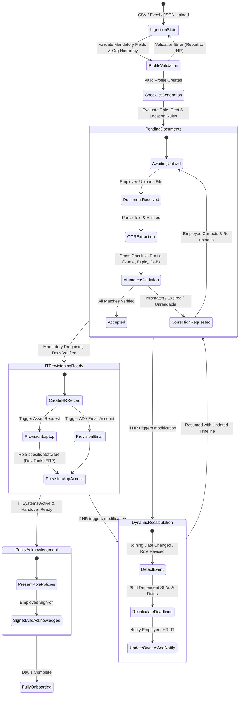
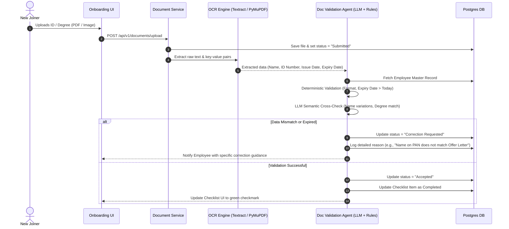
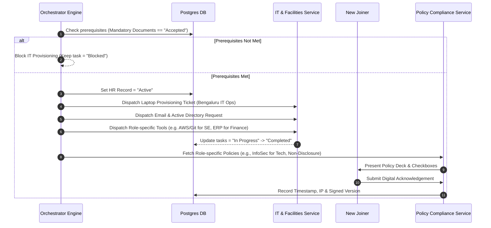
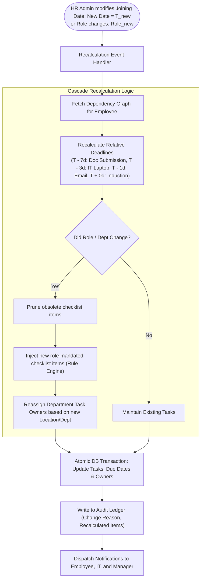
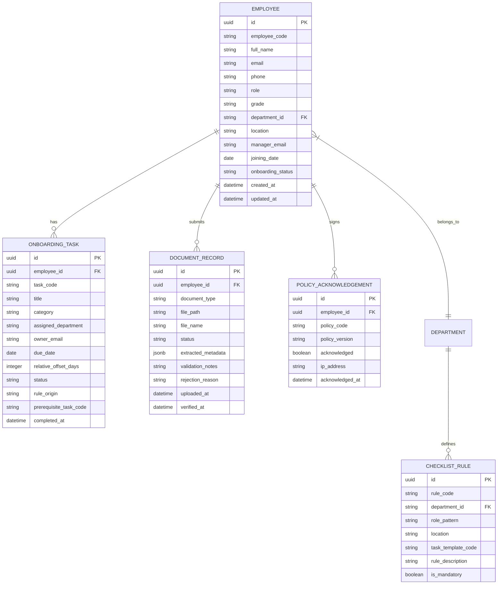

# HR Onboarding Agent — Enterprise System Architecture & Flow Diagrams
**Project**: AI-Powered Enterprise HR Onboarding Agent (Azentio Hackathon)  
**Author / Architect**: Solution Architecture Team  
**Design Standard**: Azentio Brand Theme (Mint `#00DF8F`, Midnight Navy `#0B192C`, Ice White `#FFFFFF`)  
**Deployment Target**: Dockerized Microservices / Local / AWS Free Tier Ready  

---

## 1. Executive Architecture Summary

The **HR Onboarding Agent** is designed as a modular, event-driven, multi-agent enterprise platform. It automates the end-to-end employee lifecycle—from pre-joining document submission and validation to IT provisioning, policy compliance, and dynamic schedule re-planning upon joining-date or role modifications.

### Core Architecture Pillars:
1. **Decoupled 3-Tier Layering**: Clean separation between **Presentation Layer** (Streamlit with Azentio Enterprise CSS styling), **API & Orchestration Layer** (FastAPI + LangGraph State Machine), and **Data & Vector Layer** (PostgreSQL / SQLite + Pinecone Serverless).
2. **Deterministic State Machine + Agentic Intelligence**: Critical workflow rules (dependency enforcement, IT provisioning triggers, date cascade recalculations) run deterministically via **LangGraph**, while unstructured tasks (document OCR cross-referencing, grounded policy Q&A, rejection explanations) use **LLMs (Groq Llama-3 / AWS Bedrock / GPT-4o)**.
3. **Pluggable & Cloud-Agnostic Adapters**: The design uses abstract Repository & Provider interfaces for LLMs (Groq / Bedrock / Azure), Storage (Local / AWS S3), and OCR (Local PyMuPDF/Tesseract or AWS Textract).

---

## 2. End-to-End Enterprise System Architecture

```mermaid
flowchart TD
    subgraph UI_Layer ["1. Presentation Layer (Azentio Design System)"]
        UI_Admin["HR Admin Dashboard (Streamlit / Azentio Theme)"]
        UI_Employee["New Joiner Portal (Chat + Document Hub)"]
        UI_IT["IT & Compliance Ops Console"]
    end

    subgraph API_Gateway ["2. API & Security Layer (FastAPI)"]
        Auth["Auth & Session Controller"]
        IngestionAPI["Data Ingestion Service (CSV / Excel / JSON)"]
        DocAPI["Document Management & Upload Service"]
        AgentAPI["Conversational Agent & Assistant Endpoint"]
        WorkflowAPI["Workflow & Task Recalculation API"]
    end

    subgraph Agentic_Core ["3. Multi-Agent Orchestration Layer (LangGraph State Machine)"]
        Coordinator["Master Onboarding Orchestrator"]
        DocAgent["Document Validation & OCR Extraction Agent"]
        ChecklistAgent["Dynamic Checklist & Rule Generator Agent"]
        ProvisioningAgent["IT & Systems Provisioning Agent"]
        PolicyRAGAgent["Grounded Policy Assistant (Self-Reflective RAG)"]
        RecalcEngine["Dynamic Cascade Recalculation Engine"]
    end

    subgraph Knowledge_Data_Layer ["4. Intelligence & Persistence Layer"]
        subgraph Relational_DB ["Enterprise Database (PostgreSQL / SQLite)"]
            T_Emp["Employees & Profiles"]
            T_Tasks["Onboarding Tasks & Checklists"]
            T_Docs["Document Metadata & Verification Logs"]
            T_Audit["Audit Trail & Escalations"]
        end
        subgraph Vector_Knowledge ["Vector Knowledge Base"]
            Pinecone["Pinecone Serverless (Policy Handbooks & Rules)"]
            Embeddings["HuggingFace / Groq / OpenAI Embeddings"]
        end
        subgraph Storage_Layer ["Object Storage"]
            BlobStore["AWS S3 / Local Secure Storage (Encrypted Files)"]
        end
    end

    subgraph LLM_Inference ["5. Pluggable AI / Cloud Infrastructure"]
        Groq["Groq Cloud API (Llama 3 70B / 8B Fast Inference)"]
        Bedrock["AWS Bedrock / Azure OpenAI (Enterprise Fallback)"]
        Textract["AWS Textract / Local OCR Engine"]
    end

    UI_Admin --> IngestionAPI
    UI_Admin --> WorkflowAPI
    UI_Employee --> DocAPI
    UI_Employee --> AgentAPI
    UI_IT --> WorkflowAPI

    IngestionAPI --> Coordinator
    DocAPI --> BlobStore
    DocAPI --> DocAgent
    AgentAPI --> PolicyRAGAgent
    WorkflowAPI --> RecalcEngine

    Coordinator --> ChecklistAgent
    Coordinator --> DocAgent
    Coordinator --> ProvisioningAgent
    Coordinator --> RecalcEngine

    DocAgent --> Textract
    DocAgent --> Groq
    DocAgent --> T_Docs
    DocAgent --> T_Tasks

    ChecklistAgent --> T_Tasks
    ProvisioningAgent --> T_Tasks
    RecalcEngine --> T_Tasks
    RecalcEngine --> T_Audit

    PolicyRAGAgent --> Pinecone
    PolicyRAGAgent --> Groq
    Pinecone -.-> Embeddings

    T_Emp --> Relational_DB
```



---

## 3. LangGraph Orchestration State Machine

The core onboarding lifecycle is modeled as a cyclic directed state graph with deterministic guardrails.



---

## 4. Scenario-Specific Flow Diagrams

### Scenario 1: Document Collection, OCR & Verification Loop
Cross-references extracted entities against the employee master record to prevent onboarding fraud or clerical errors.



---

### Scenario 2 & 3: IT Provisioning & Role-Specific Policy Acknowledgement



---

### Scenario 4: Dynamic Joining-Date and Role Change Recalculation Engine
Demonstrates resilience to business changes without manual HR re-planning.



---

### Scenario 5: Grounded Policy Q&A Assistant (Zero-Hallucination RAG)

```mermaid
flowchart LR
    subgraph Query_Flow ["User Query"]
        Q["Employee asks: 'How many leaves can I take during probation?'"] --> Guardrail["Guardrail & Intent Classifier"]
    end

    subgraph Context_Retrieval ["Grounded Hybrid Search"]
        Guardrail --> ContextInject["Inject Employee Metadata (Role, Dept, Location, Grade)"]
        ContextInject --> HybridSearch["Pinecone Serverless Hybrid Search (Metadata Filtered)"]
        HybridSearch --> Rerank["Cross-Encoder Reranker"]
        Rerank --> PolicyDoc["Retrieved Official Azentio Policy Excerpt + Doc ID"]
    end

    subgraph Grounded_Generation ["Strict Prompt Generation"]
        PolicyDoc --> PromptBuilder["Build Grounded Prompt (Strict Rule: Use ONLY provided context)"]
        PromptBuilder --> GroqLLM["Groq Llama-3 70B / Bedrock"]
        GroqLLM --> CitationCheck["Citation & Hallucination Verifier"]
    end

    CitationCheck --> Response["Grounded Answer with Policy Section Citation<br/>(e.g., 'Per Azentio Leave Policy v3.2, Sec 4.1...')"]
```



---

## 5. Enterprise Data Models (Relational Schema)



---

## 6. Project Directory Structure

```text
HR_Onboarding_Agent_Azentio_Hackathon/
├── .github/
│   └── workflows/
│       └── ci-cd.yml                # Automated linting & test suite
├── docker/
│   ├── Dockerfile.backend           # FastAPI container
│   ├── Dockerfile.frontend          # Streamlit Azentio UI container
│   └── docker-compose.yml           # Multi-service local orchestrator
├── data/
│   ├── sample_profiles/             # Ingestion test data (.csv, .xlsx, .json)
│   ├── policies/                    # Official company handbooks & PDFs for RAG
│   └── rules/                       # Role, Dept & Location checklist mapping rules
├── src/
│   ├── app/                         # Presentation Layer (Streamlit)
│   │   ├── main.py                  # Streamlit entry point with Azentio navigation
│   │   ├── styles/
│   │   │   └── azentio_theme.css    # Strict Azentio Brand CSS (Mint #00DF8F, Navy #0B192C)
│   │   ├── components/              # Modular UI components (Cards, Badges, Metrics)
│   │   └── views/
│   │       ├── admin_dashboard.py   # HR metrics, filterable progress table, date changer
│   │       ├── employee_portal.py   # Document uploader, checklist viewer, policy signer
│   │       └── assistant_chat.py    # Grounded Conversational AI chat with citations
│   │
│   ├── api/                         # REST API Layer (FastAPI)
│   │   ├── main.py                  # FastAPI app & routing
│   │   ├── routers/
│   │   │   ├── ingestion.py         # CSV/Excel/JSON upload & validation endpoints
│   │   │   ├── employees.py         # Employee CRUD & date/role updates
│   │   │   ├── documents.py         # File upload & verification trigger endpoints
│   │   │   ├── tasks.py             # Checklist & task status endpoints
│   │   │   └── chat.py              # Conversational agent query endpoint
│   │   └── schemas/                 # Pydantic v2 validation contracts
│   │
│   ├── core/                        # Business Logic & Orchestration
│   │   ├── config.py                # Environment settings & secrets
│   │   ├── state_machine.py         # LangGraph workflow & state graph
│   │   ├── rule_engine.py           # Checklist & dependency rule evaluator
│   │   └── recalculation_engine.py  # Dynamic date/role cascade recalculator
│   │
│   ├── agents/                      # Specialized Agent Implementations
│   │   ├── doc_validation_agent.py  # OCR extractor & discrepancy analyzer
│   │   ├── provisioning_agent.py    # IT asset & email provisioning pipeline
│   │   └── policy_rag_agent.py      # Grounded RAG with source citation verification
│   │
│   ├── database/                    # Persistence Layer
│   │   ├── session.py               # SQLAlchemy async engine & session
│   │   ├── models.py                # PostgreSQL ORM entities
│   │   └── repository.py            # Data access object pattern
│   │
│   └── services/                    # Cloud & Third-Party Adapters
│       ├── ocr_service.py           # Pluggable OCR (PyMuPDF / AWS Textract)
│       ├── vector_store.py          # Pinecone Serverless client & index manager
│       └── llm_provider.py          # Groq / AWS Bedrock / OpenAI dynamic client
│
├── tests/                           # Verification & Quality Assurance
│   ├── test_ingestion.py            # Tests for CSV/Excel/JSON schema validation
│   ├── test_rule_engine.py          # Tests for checklist generation rules
│   ├── test_recalculation.py        # Tests for date-change cascade propagation
│   └── test_policy_rag.py           # Tests for zero-hallucination ground truth
│
├── .env.example                     # Sample environment variable template
├── flow diagram.md                  # This master architectural blueprint
├── README.md                        # Project documentation & presentation guide
└── requirements.txt                 # Python dependencies
```

---

## 7. Tech Stack & Resource Allocation

| Component | Technology | Rationale / Skill Fit |
| :--- | :--- | :--- |
| **Backend Framework** | **FastAPI + Pydantic v2** | High-performance async APIs, strict typing, auto-generated OpenAPI docs. |
| **Agentic Framework** | **LangGraph** | Cyclic state graphs, deterministic human-in-the-loop approvals, state persistence. |
| **Frontend Framework** | **Streamlit** | Rapid hackathon delivery with custom Azentio CSS branding (`#00DF8F`, `#0B192C`). |
| **LLM Inference** | **Groq Cloud (Llama-3-70B/8B)** | Sub-second inference latency, generous free tier, outstanding reasoning. |
| **Vector DB** | **Pinecone Serverless** | 100% Free Starter tier, native AWS us-east-1 hosting, metadata filtering (role/location). |
| **OCR & Parsing** | **PyMuPDF / AWS Textract** | Structured key-value pair extraction from identity documents and certificates. |
| **Primary Database** | **PostgreSQL (or SQLite for local test)** | Robust ACID transactions, relational integrity, JSONB support. |
| **Cloud Infrastructure** | **Docker + AWS Free Tier (S3/EC2)** | Clean containerized deployment, portable across all development environments. |

---

## 8. Alignment with Evaluation Criteria & Next Steps

1. **Enterprise Reality**: Avoids fragile, hardcoded scripts; uses production-grade state machines and rule engines.
2. **Resilience to Change**: Handles real-world delays, document rejections, and schedule adjustments automatically.
3. **Auditability & Traceability**: Every generated task carries the exact rule origin; every AI answer cites source policy files.
4. **Hackathon Winning Factor**: Clean, responsive Azentio-branded UI backed by a resilient, observable multi-agent engine.

